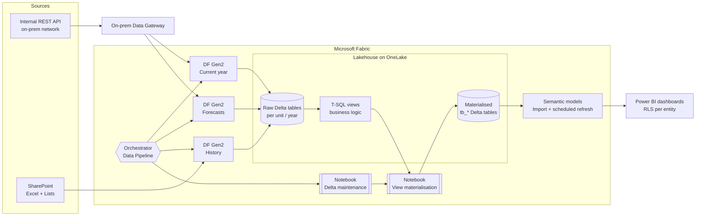

# Microsoft Fabric & OneLake — Capacity Recovery and Lakehouse Restructuring

> **Case study** · Public-sector healthcare procurement (Portugal) · Microsoft Fabric, OneLake, Lakehouse, Dataflows Gen2, Data Pipelines, PySpark Notebooks, T-SQL, Power BI, On-premises & VNet Data Gateways
>
> 🇵🇹 [Versão em português](README.pt.md)

A production Fabric capacity was running at **up to 365% utilisation**, throttling refreshes and slowing every dashboard used to monitor public procurement across hospitals. I diagnosed the root causes, restructured the OneLake/Lakehouse layer, redesigned the ingestion and refresh strategy, and assessed the gateway/network architecture needed to move ingestion from Dataflows to Spark notebooks.

*Client names, servers, IPs, accounts and connection strings have been anonymised. All code in this repo is a sanitised, generic version of what ran in production.*

---

## At a glance

| | |
|---|---|
| **Problem** | Capacity throttling (peaks of 365%), failed refreshes, slow reports, fragile on-prem gateway |
| **Role** | Fabric / BI engineer — diagnosis, architecture, implementation, IT liaison |
| **Stack** | Fabric Lakehouse (Delta), OneLake, Dataflows Gen2, Data Pipelines, PySpark, T-SQL (SQL analytics endpoint), Power BI semantic models, On-prem Data Gateway, VNet Data Gateway (assessment) |
| **Data sources** | Internal REST API (back-office/catalogue), SharePoint (Excel + Lists), OneLake-native reference tables |
| **Consumers** | Power BI dashboards with row-level security per hospital/entity |

## Architecture (after)



Full write-up: [`docs/architecture.md`](docs/architecture.md)

## What I did

1. **Diagnosed the capacity problem** using the *Fabric Capacity Metrics* app — identified the items driving CU consumption and throttling, and traced them to five root causes:
   - semantic model in **DirectQuery** hitting the Lakehouse on every visual interaction
   - **non-materialised SQL views** recalculated on every read
   - one monolithic dataflow mixing extraction and transformation for all sources and years
   - **Delta tables without maintenance** (no `OPTIMIZE` / `VACUUM`) → small-file fragmentation
   - a model without star schema (N:N relationships)
2. **Restructured ingestion by refresh frequency** — split one dataflow into *current year* (daily), *forecasts*, and *history* (rarely changes), so historical years stop being re-ingested every day.
3. **Materialised the view layer** — a PySpark notebook reads each business view and writes it as a physical Delta table (`vw_X → tb_X`); semantic models were repointed to the `tb_` tables. → [`notebooks/`](notebooks/)
4. **Added Delta maintenance** — scheduled `OPTIMIZE` + `VACUUM` notebook across Lakehouse tables.
5. **Switched semantic models from DirectQuery to Import** with scheduled refresh aligned to real data freshness needs.
6. **Orchestrated everything in one Data Pipeline** (dataflows → maintenance → materialisation → model refresh), replacing independent, overlapping schedules.
7. **Gateway & network architecture** — operated the on-prem gateway, handled a power-outage incident end-to-end, and produced the VNet Data Gateway design (VNet + delegated subnet + RBAC + NSG) for a future move to notebook-based ingestion — then recommended **deferring** it after confirming the target design didn't need it in this phase. → [`gateway/`](gateway/)
8. **Documented a 3-phase roadmap** (quick wins → structural → star schema remodel) for the client's team.

## Results

| Change | Effect |
|---|---|
| DirectQuery → Import + scheduled refresh | Report interactions no longer consume Lakehouse CUs; faster dashboards |
| Views materialised as Delta tables | Business logic computed once per load instead of on every query |
| Dataflow split by frequency | Historical years no longer re-ingested daily |
| Delta maintenance | Fewer small files, faster scans |
| Single orchestrating pipeline | Predictable load order, fewer overlapping jobs, one place to monitor |


## Repository map

```
├── docs/
│   ├── architecture.md          Before/after architecture, Lakehouse layout, naming conventions
│   ├── diagnosis.md             How the throttling was diagnosed (Capacity Metrics method)
│   └── roadmap.md               3-phase improvement plan
├── notebooks/
│   ├── materialize_views.py     PySpark: vw_* → tb_* Delta tables, with logging and failure handling
│   └── delta_maintenance.py     PySpark: OPTIMIZE + VACUUM across Lakehouse tables
├── sql/
│   ├── consolidated_views.sql   Year-partitioned tables → consolidated views
│   └── data_quality_checks.sql  Finding bad dates / types before they break a load
├── pipelines/
│   └── orchestrator.md          Pipeline design and activity order
└── gateway/
    ├── vnet-gateway-design.md   VNet Data Gateway: when you need it, what IT must provision
    ├── gateway-decision.md      On-prem vs VNet gateway — trade-offs and the decision taken
    └── incident-runbook.md      Gateway outage runbook (from a real incident)
```

## Related projects

- [powerbi-procurement-analytics](https://github.com/Daimartinsk/powerbi-procurement-analytics) — the analytics layer on top of this Lakehouse: analytical views, DAX measures, semantic model and row-level security
- [excel-vba-dynamic-request-form](https://github.com/Daimartinsk/excel-vba-dynamic-request-form) — dynamic Excel/VBA request form with Outlook submission

## Certification

Microsoft Certified: Fabric Analytics Engineer Associate (DP-600) — in preparation.

## Services I offer

- Microsoft Fabric **capacity health checks** and CU/throttling reduction
- **OneLake / Lakehouse design** — medallion layers, Delta maintenance, naming and workspace structure
- Migration from **Dataflows Gen2 to Pipelines + Notebooks**
- **Gateway** setup and troubleshooting (on-prem and VNet)
- Power BI **semantic model** tuning (Import / Direct Lake, RLS, star schema)

📫 **Contact:** daianamartinsk@gmail.com · [LinkedIn](https://www.linkedin.com/in/daiana-martins-37b636181)
