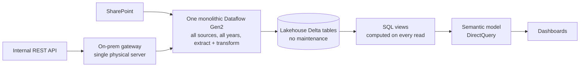
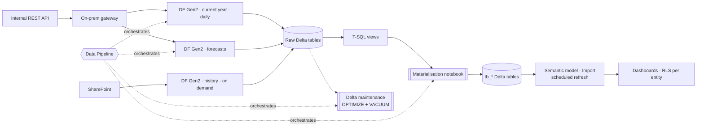

# Architecture

## Before

**Why this hurt capacity:** every report click → DirectQuery → SQL view recomputed over fragmented Delta files. Meanwhile, a single dataflow re-ingested all historical years on each run. Result: CU consumption far above the purchased SKU, throttling, and failed refreshes.

## After

## Lakehouse layout

| Layer | Objects | Naming | Written by |
|---|---|---|---|
| Raw | One table per business unit and year from the API | `<Source>_<Unit>_<YYYY>` | Dataflows Gen2 |
| Raw | Historical extracts (multi-year) | `<Source>_<Unit>_<YYYY>_<YYYY>` | History dataflow |
| Reference | Calendar, price lists, entity master data | Descriptive names | OneLake-native / SharePoint |
| Logic | ~10 business views: consolidated, per-unit, working-day calculations, monthly/annual KPIs, forecasts | `vw_<Subject>` | T-SQL on SQL analytics endpoint |
| Serving | Materialised copies of the views | `tb_<Subject>` | PySpark notebook |

### Design decisions

- **Year-partitioned raw tables + `UNION ALL` views.** Adding a year = one new table and one line in the view; past years are never rewritten.
- **Views stay the single source of business logic.** Analysts edit T-SQL; the notebook only materialises. No logic is duplicated in PySpark.
- **`tb_` tables are what models read.** Same schema as the view, so repointing a model is a one-line change in Power Query (`Item="vw_X"` → `Item="tb_X"`).
- **Lakehouse vs. OneLake** — OneLake is the tenant-wide storage; the Lakehouse is this domain's scoped space in it. Teams elsewhere can shortcut to `tb_` tables without copying data.

## Refresh strategy

| Data | Changes | Refresh |
|---|---|---|
| Current year | Daily | Daily, early morning |
| Forecasts | Periodically | Scheduled with current year |
| History | Rarely | On demand |
| Reference | Rarely | On demand |

Real-time was evaluated and rejected: procurement data doesn't change by the second, and continuous refresh would worsen the CU problem.

**Gotcha documented for the client:** Power BI pauses scheduled refreshes on models whose reports haven't been opened for ~2 months.
