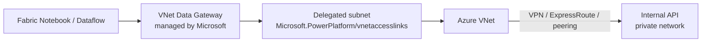

# VNet Data Gateway — design

## When you need it
Spark notebooks run in Fabric's cloud and **cannot reach private IPs** (e.g. an internal API on `10.x.x.x`). Dataflows can, via an on-premises gateway. To move ingestion of a private source from Dataflows to notebooks/pipelines without a physical gateway server, you need network-level connectivity: a **Virtual Network Data Gateway**.

## What IT must provision

| # | Item | Detail |
|---|---|---|
| 1 | Azure VNet | In the organisation's subscription, with routing to the private source |
| 2 | Dedicated subnet | Delegated to `Microsoft.PowerPlatform/vnetaccesslinks`; **exclusive** to this delegation |
| 3 | RBAC | The Fabric admin account needs **Contributor** (or equivalent) on the subscription/VNet to create the gateway |
| 4 | NSG / firewall | Allow traffic from the subnet to the source host and port |
| 5 | Resource provider | `Microsoft.PowerPlatform` registered on the subscription |

## What I do in Fabric afterwards
1. *Manage connections and gateways* → *Virtual network data gateways* → New
2. Select subscription, VNet and delegated subnet
3. Create the connection to the source using that gateway
4. Test with one endpoint before migrating the rest

## Why it's preferable to a physical gateway server
- No hardware or OS to patch; no single machine that a power cut can take down
- Managed and encrypted by Microsoft; traffic stays within Azure networking, auditable
- Scales without new installs

Trade-off: requires Azure networking set up by IT, and consumes capacity while in use.
