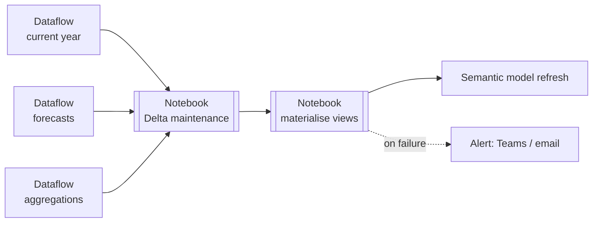

# Orchestrating Data Pipeline

One pipeline replaces independent, overlapping schedules on each dataflow, notebook and model.

| Step | Activity | Depends on | Notes |
|---|---|---|---|
| 1 | Dataflow Gen2 — current year | — | Runs in parallel with 2–3 |
| 2 | Dataflow Gen2 — forecasts | — | |
| 3 | Dataflow Gen2 — aggregations | — | |
| 4 | Notebook — Delta maintenance | 1, 2, 3 succeeded | Compact before reading |
| 5 | Notebook — materialise views | 4 | Raises on failure so the pipeline goes red |
| 6 | Semantic model refresh | 5 succeeded | Models read `tb_*` only |
| — | Notification | any failure | |

**Not in the daily run:** history dataflow and reference tables — triggered on demand.

**Schedule:** once daily, early morning, outside working hours so background CUs don't compete with interactive report use.

### Lesson learned
A notebook that catches every exception and finishes "successfully" hides failures from the pipeline. The materialisation notebook logs per-view results **and** raises at the end if anything failed, so monitoring shows red when it should.
